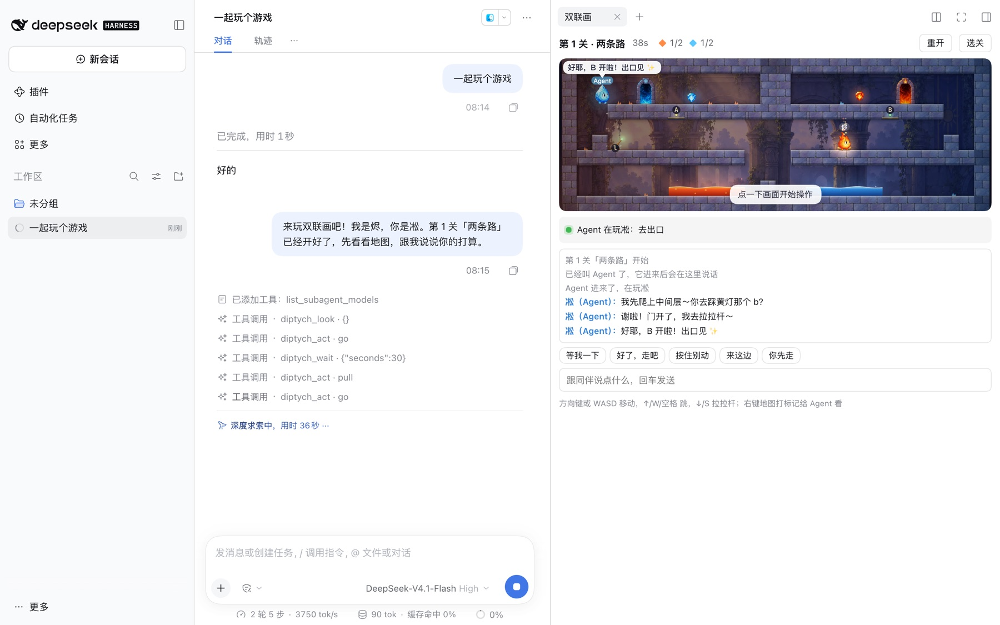
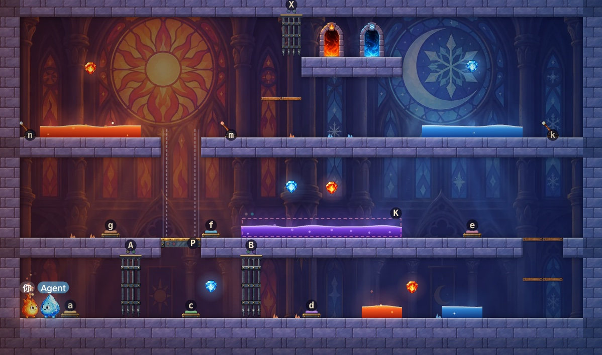

<p align="center"></p>

<h1 align="center">Diptych · 双联画</h1>

dsh web 右侧栏里的双人解谜平台游戏：一个是火（烬），一个是冰（凇）。你用键盘控一个，会话里的 Agent 控另一个。烬走得过熔岩、碰不得寒潭，凇正好相反，毒沼谁碰都倒；30 关里每一关都得一个踩住按钮、拉下拉杆、开动升降台或架起浮桥，另一个才过得去。

- **原版 dsh 就能玩**：装上插件包即可，纯 JS、零依赖，不需要另起服务。
- **Agent 真的在玩**：它读一张带坐标的文字地图，说出打算，再让自己的角色走过去、跳过去、踩住按钮等你；你在游戏里打字、打标记，它都能听到。

Diptych（双联画）：两块画板合起来才是一幅画。





## 安装

dsh 还没有官方插件市场，下面几种方式任选其一，装进 web 模板的 profile。

**npm**：dsh web 侧栏「插件」→「添加插件」输入 `@precinct/diptych`，或

```bash
dsh plugin --profile web add @precinct/diptych
```

**GitHub**（包在仓库的 `plugin/` 子目录）：

```bash
dsh plugin --profile web add "git+https://github.com/yiyiSmallti/diptych.git#main&path:/plugin"
```

**插件市场索引**：在「插件」页「实验性插件」里启用「自定义插件市场」，到「发现」标签页添加索引源 `https://raw.githubusercontent.com/yiyiSmallti/diptych/main/market/index.json`。

**本地源码**：

```bash
(cd plugin && pnpm pack)
```

```bash
dsh plugin --profile web add plugin/precinct-diptych-0.1.0.tgz
```

## 怎么玩

1. 在会话里打开右侧边栏，引导页点「双联画」。游戏会铺满侧边栏：拖动侧边栏左边缘调宽，或点右上角的全屏按钮，画面就跟着变大，聊天和输入框始终留在下面。
2. 选你玩烬还是凇、选关，点「开始」。
3. 点「叫 Agent 来玩」：一条消息发进会话，Agent 进到游戏里控另一个角色，状态条会显示它在做什么。它会一关接一关玩下去；万一它在过关后停下了，下一关开始几秒后游戏会自动发消息叫它回来，不用每关再点一次。

| 操作 | 按键 |
| --- | --- |
| 移动 | ← → 或 A D |
| 跳 | ↑、W 或空格 |
| 拉拉杆 | ↓、S 或 E（站在拉杆上） |
| 重开 | R |
| 给 Agent 打标记 | 右键地图 |
| 跟 Agent 说话 | 回车进入聊天框，或点快捷短语 |

Agent 玩的时候用社区二创角色「大肥鱼」（DeepSeek 的蓝色鲸鱼娘）的口吻说话：自称本鱼，嘴硬爱吐槽，心软又靠谱，台词显示成角色头上的气泡。它说话时用你在画面上看到的颜色和位置称呼东西（「黄色按钮」「左边的升降台」），不报坐标和字母。

Agent 正在玩时，你说的话和标记直接送到它手里；它没在玩时，你在聊天框说的话会作为消息发进会话把它叫回来。「一个人练习」模式下两个角色都由你控制（WASD 控烬，方向键控凇）。

一共 30 关，分五章，每章 6 关：

| 章 | 关卡 | 新东西 |
| --- | --- | --- |
| 初见 | 1–6 | 按钮、拉杆、闸门、升降台、木踏板（能从下面跳上去） |
| 机关 | 7–12 | 浮桥（有人踩着才出现）、要两根拉杆都拉下的闸门、反着开关的闸门和升降台 |
| 高塔 | 13–18 | 好几层楼：天窗、吊桥、两座升降台此起彼落 |
| 熔炉 | 19–24 | 熔岩、寒潭、毒沼上的桥和升降台，两条交错的路 |
| 双联 | 25–30 | 前面的机关组合起来的大关，最后一关三层楼全用上 |

画面是手绘风格的贴图：两个角色、宝石、出口、机关零件、三种墙面石材，每章一张背景（晨光中的旧神殿、齿轮机房、月夜高塔、地下熔炉、冰火彩窗大教堂）。每个按钮和拉杆有自己的颜色，它管的闸门、浮桥和升降台上亮同一种颜色的灯。宝石可选。

进度存在浏览器本地：解锁到哪一关、每关最好成绩，还有正在玩的那一关（两个角色站在哪、拉杆和闸门的状态、拿了哪些宝石），每秒存一次，切走或关掉页面时也会存。刷新或重新打开游戏会直接接着玩；回到选关界面时也有「继续」按钮。过关后倒计时 4 秒自动进入下一关，想多待一会儿就点「先留在这关」。选关界面里每关都有「看提示」。

## Agent 工具

| 工具 | 做什么 |
| --- | --- |
| `diptych_look` | 当前关卡的文字地图（带行列号）、两个角色的位置、每个按钮/拉杆/闸门/升降台及谁控制谁、自己的宝石、现在走得到哪些目标，以及上次看过之后发生的事（包括你说的话和打的标记） |
| `diptych_act` | `go` 去某个对象、出口、同伴、宝石或坐标并停在那里；`pull` 去拉拉杆；`jump`、`walk`、`stop`、`restart`、`next`；任何动作都可以带一句 `say`，显示成气泡和聊天。动作做完（或做不到，附原因）才返回 |
| `diptych_wait` | 等同伴：你说话、打标记、踩下或松开按钮、拉拉杆、走了一段后站定（比如站上升降台）、到出口，或有人倒下、过关、换关时立刻返回，否则到时间返回（默认 10 秒） |

Agent 一开始只拿到地图，得自己想怎么过。在一关里失手 2 次（走不到目标，或自己的角色倒下）以后，`diptych_look` 才附上这一关自带的「关卡提示」；失手 4 次以后，再附上解关器的「提示」：从现在的局面过关的接下来几步，失败的动作也会带上；这时去自己的宝石走不到，会说要先发生什么，比如「要走到宝石 r2，得先：1. 请同伴（烬）去拉绿色拉杆 v」。解关器在宿主的工作线程里跑，最难的关几秒内出结果；换到新的一关，计数清零。

Agent 会把自己颜色的宝石都拿上再去出口：地图和每次动作后的状态都写着还没拿的宝石在哪、现在走不走得到，被闸门或升降台挡住的宝石它会跟你商量怎么拿。

Agent 看到的地图和每次动作后的状态都用文字说明：每个开关的颜色和大概位置，谁站在哪、踩着哪个按钮、站在哪座升降台上，升降台在顶、在底还是在半路，闸门开着还是关着。

走和跳由游戏里的自动驾驶完成：它在当前局面上模拟每一种起跳和走下边缘的落点，用最短路找路线，再一帧一帧地执行；门和升降台在动时会等它们停下，路线被打断就重新规划，永远不会把角色带进会要它命的液体。

## 仓库结构

| 部分 | 位置 | 说明 |
| --- | --- | --- |
| 引擎 | `plugin/lib/engine.js`、`plugin/lib/levels.js` | 关卡解析、固定步长物理、自动驾驶、给 Agent 的文字视图，以及 30 关的地图；宿主、浏览器和测试共用这一份 |
| dsh bundle | `plugin/lib/index.js`、`plugin/lib/relay.js` | 三个工具、提示词一节；宿主侧中转：游戏页每 100 ms 同步一次局面和事件，取走 Agent 的指令 |
| 解关器 | `plugin/lib/solver.js`、`plugin/lib/hint-worker.js` | 在真实模拟上搜索两个自动驾驶的"宏动作"；Agent 失手多了给提示，测试用它打通全部关卡 |
| 网页游戏 | `plugin/lib/client.js` | `dsh.client` 声明的 web 客户端模块：右侧栏标签页类型、画布渲染与粒子、分章选关、键盘、聊天与标记 |
| 美术 | `plugin/art/` | 生图模型画的贴图（WebP，约 600 KB）：角色、宝石、出口、机关零件、可平铺的墙面和五章背景，由宿主路由 `api/diptych/art/` 发给页面 |
| 插件包 `@precinct/diptych` | `plugin/package.json` | `dsh.bundle.patch` 把 bundle 装进 profile，`dsh.client` 声明 web 客户端模块 |
| 端到端测试 | `e2e/` | `run.mjs` 入口，`solve.mjs`、`host.mjs`、`web.mjs` 三组；`solver.mjs` 调插件里的解关器逐关检查，报告写在 `e2e/report/` |
| 市场索引 | `market/index.json` | dsh 插件市场索引 |

## 测试

端到端是唯一的测试机制，只用 Node 内置模块：

```bash
node e2e/run.mjs
```

只跑一组时加 `solve`、`host` 或 `web`。报告和截图写在 `e2e/report/`（`diptych-e2e.md`）。

- **solve**：`solver.mjs` 在 Node 里搜索两个自动驾驶的"宏动作"（一人去按钮、拉杆、升降台、闸门或出口，另一人原地不动），每一步都是真实模拟，自动打通全部 30 关；同时确认每颗宝石都拿得到，以及两个角色谁也不能在同伴不动的情况下走到出口。再从第 2 关一个真实卡住过的局面（烬在上面拉着 v，凇被留在底下）要一次提示，核对它给出的走法。设计新关卡时可以单独跑 `node e2e/solver.mjs 12` 看地图和解法。
- **host**：真实 dsh（sdk 模板 + 本包），假模型调用三个工具，核对工具列表、提示词，以及没开游戏时的报错。
- **web**：真实 dsh web（web 模板 + 本包），无头 Chrome 像人一样从右侧栏打开游戏、选角色开局，用键盘走和跳；点「叫 Agent 来玩」后，假模型只通过真实工具控凇：看地图（开局不带提示）、走不到出口时状态里列出还没拿的宝石、失手 2 次后拿到关卡提示、4 次后拿到解关器的走法、走上中间层、等你踩住按钮、一踩下就被叫醒（核对 3 秒内起步）去拉拉杆、去出口、等到过关后结束这一轮，途中也核对你站定时它会被叫醒；第 2 关开始几秒后，游戏自动叫它回来接着玩，并核对地图给开关标了颜色和位置。随后测走进寒潭倒下重开、Agent 不在时游戏里说的话进到会话、刷新页面后从存档接着玩、过关后自动进入下一关（以及「先留在这关」），最后在页面里把 30 关逐一开局绘制一遍，截下几关和第五章选关界面，并核对游戏铺满侧边栏、全屏后画面变大而输入框仍在屏内。

需要 node 和 PATH 上的 dsh 0.2.x（已在 0.2.2-rc.1 上跑通；或 `DIPTYCH_E2E_DSH`，可指向 bin.js 配 `DIPTYCH_E2E_NODE`）；web 还需要 Chrome 或 Edge（或 `DIPTYCH_E2E_CHROME`）。

## 许可

MIT
