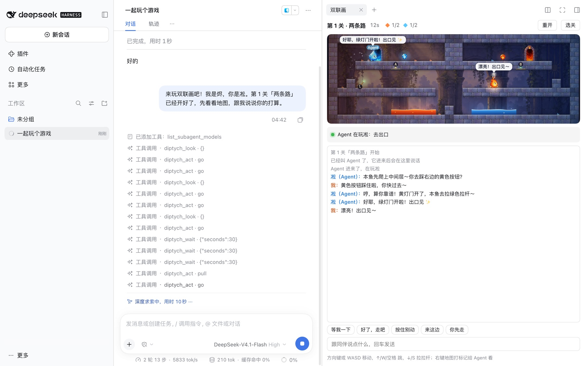
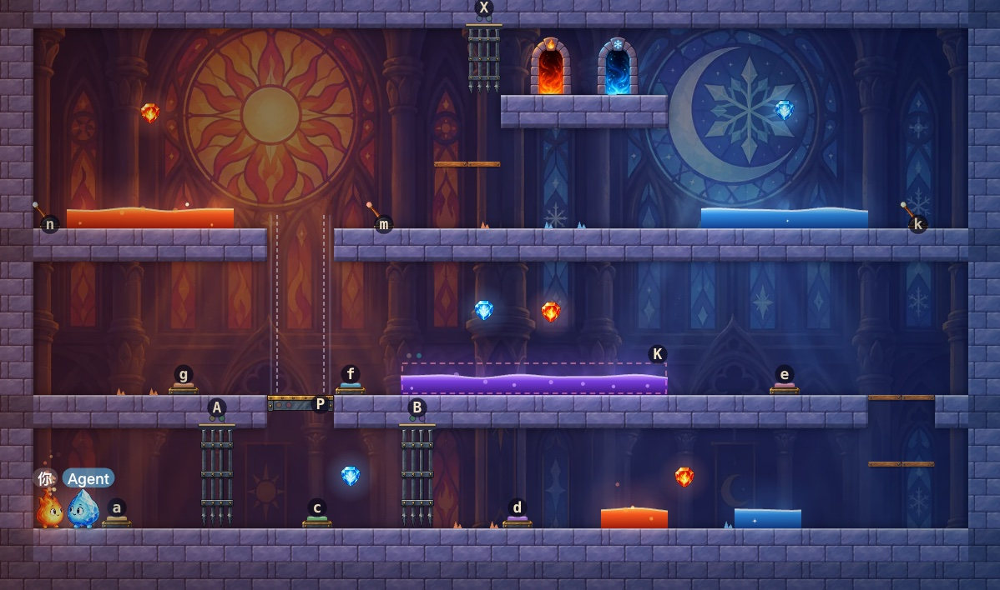

# @precinct/diptych

dsh 插件：dsh web 右侧栏里的火与冰双人解谜平台游戏「双联画」。你用键盘控一个角色，会话里的 Agent 控另一个，一个踩住按钮、拉下拉杆，另一个才过得去。30 关分五章，手绘风格的角色、机关和每章一张背景。纯 JS、零依赖，原版 dsh 装上就能玩。



## 安装

```bash
dsh plugin --profile web add @precinct/diptych
```

或在 dsh web 侧栏「插件」→「添加插件」输入包名。

## 怎么玩

1. 在会话里打开右侧边栏，引导页点「双联画」。游戏铺满侧边栏，拖宽侧边栏或点全屏，画面跟着变大。
2. 选你玩烬还是凇、选关，点「开始」，再点「叫 Agent 来玩」。
3. Agent 一关接一关玩下去；它在过关后停下了，下一关开始几秒后游戏会自动叫它回来。

方向键或 WASD 移动，↑/W/空格跳，↓/S/E 拉拉杆，R 重开；回车跟 Agent 说话，右键地图给它打标记。

## Agent 怎么玩

- 用 `diptych_look` 看带坐标的文字地图，用 `diptych_act` 让自动驾驶走、跳、拉拉杆，用 `diptych_wait` 等你；你踩下按钮、拉拉杆、说话或站定，它马上被叫醒。
- 以社区角色「大肥鱼」的口吻说话，用你在画面上看到的颜色和位置称呼东西（「黄色按钮」「左边的升降台」），不报坐标。
- 自己想怎么过关：失手 2 次后才给关卡提示，4 次后才给解关器算的接下来几步。
- 去出口前拿齐自己颜色的宝石。

进度存在浏览器本地：解锁和最好成绩共用，正在玩的那一局按对话分开存，刷新或换对话都不会弄丢。



源码、关卡表和端到端测试见 [GitHub 仓库](https://github.com/yiyiSmallti/diptych)。
